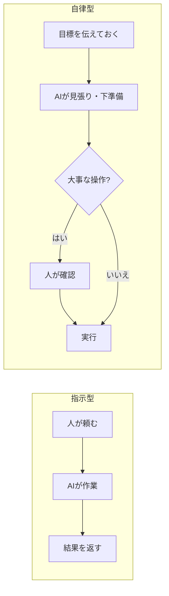

# 【比較】指示型AIと自律型AIの違い（Claude Code・Projects・GPTs・dots・Duet）

!!! note "2026-11 時点の情報です"
    dots と Duet は出たばかりの機能です。提供範囲や料金は変わりやすいので、使う前に公式の案内を確かめてください。出典は末尾にまとめています。

## 概要

AI の使い方は、大きく2つに分かれてきました。

- **指示型**：人が頼んだときに動く。Claude Code、Claude Projects、GPTs がこちら
- **自律型（秘書AI）**：目標を伝えておくと、AI のほうから動く。アプリを閉じてもクラウド上で作業を続ける。ChatGPT dots と Claude Duet がこちら

この記事では、5つのツールを「誰が動き出すか」「どこまで任せるか」で並べ、どんな場面でどれを使うかを整理します。

## 例えるなら

- **指示型** は「腕のいい外注先」です。頼めば早く正確に仕上げてくれますが、頼まなければ何もしません
- **自律型** は「秘書」です。毎朝の予定やメールを見て、先回りして声をかけてくれます。ただし、お金を払う・メールを送るといった大事なことは、主人の確認を取ってから行います

## 詳細比較

| 項目 | Claude Code | Claude Projects | GPTs | ChatGPT dots | Claude Duet |
| --- | --- | --- | --- | --- | --- |
| 型 | 指示型 | 指示型（並列で進める） | 指示型 | 自律型 | 自律型 |
| 誰が動き出すか | 人 | 人（作業の分担は Claude） | 人 | AI | AI |
| 主な用途 | コード・ファイルの作業 | 大きな目標を分けて同時に進める | 用途ごとのオリジナル AI を作る | 続く仕事を任せる | 受信箱や予定の整理、先回りの声かけ |
| 動く場所 | 手元の端末かクラウド | クラウド（今はクラウドのみ） | ChatGPT の中 | 専用のクラウドの PC とブラウザ | クラウド（数時間ごとに確認） |
| 連携・窓口 | ターミナル、IDE、Web | プロジェクト画面（Overview） | ChatGPT、GPT ストア | 4,000以上のアプリ。ChatGPT・Slack・Teams から話しかけられる | iOS・Android・claude.ai |
| 人の確認 | 権限の設定次第 | PR のマージは人 | 会話ごとに人が見る | 任せる範囲を自分で決める | 送信・支払い・署名・削除の前に必ず承認 |
| 提供状況（2026-11） | 一般提供 | 9/17 に刷新。Pro・Max の一部で先行提供 | 一般提供 | 9/29 発表。Pro と Business Premium（対象地域） | 10/21 から試験提供。米国の Pro・Max が順番待ち |
| 料金 | 契約の範囲 | 契約の範囲（並列にすると早く減る） | 契約の範囲 | 最初の1体は契約に含まれる | 試験中は追加料金なし。Claude の利用枠を使う |

## それぞれの詳細

### Claude Code（指示型）

ターミナルや IDE で、人が頼んだ作業をこなします。ファイルを読み書きし、コマンドを実行し、コードを直します。何をどこまで自動でやらせるかは、権限の設定で決めます。

### Claude Projects（指示型の発展形）

9/17 の刷新で、ファイルや会話を置いておく場所から「取りまとめ役」に変わりました。大きな目標を作業の単位（スレッド）に分け、スレッドごとに Claude Code のクラウドセッションを同時に動かします。リポジトリを使うスレッドは自分のブランチで作業し、結果は PR にまとまります。

**自分から動き出すわけではありません**。人が頼んだあとの作業を、Claude が分担して同時に進める仕組みです。今はクラウドだけで動き、スレッド1本が1セッション分なので、並列にするほど利用枠が早く減ります。

### GPTs（指示型）

ChatGPT の中で、指示文や資料を入れたオリジナル AI を作る機能です。「議事録係」「3C分析係」のように用途ごとに作り分け、社内で共有できます。使うたびに人が話しかける、典型的な指示型です。

### ChatGPT dots（自律型）

会話していない間も、目標に向けて働き続ける AI です。1体ごとに専用のクラウドの PC とブラウザを持ち、4,000以上のアプリとつながります。ChatGPT のほか、Slack や Teams からも話しかけられます。メールのミスや曜日の間違いを、指示なしで見つける例も紹介されています。

提供範囲は、記事によって書き方が違います。海外の報道では「Pro と Business Premium の対象地域」です。一方、日本語の解説動画では「日本でも有料プランで使える」「週に使う人の数は日本が世界2位」とされていました。使えるかどうかは、自分の画面で確かめてください。

### Claude Duet（自律型）

AI のほうから連絡してくる、秘書型のエージェントです。毎朝やることをまとめて届け、受信箱や予定を整えます。**メッセージの送信・お金の支払い・書類への署名・内容の削除の前には、必ず人の承認を取る**作りです。

つないだアカウントは、常に見ているのではなく数時間ごとに確認します。Anthropic 自身も「やりとりを読み違えたり、急ぎかどうかを見誤ったりすることがある」と、初期版であることを断っています。今は米国の Pro・Max 利用者が順番待ちで試せる段階で、Team と Enterprise は対象外です。

## よくある誤解

- **「Projects も自律型になった」** → 違います。並列で進むのは人が頼んだあとの作業で、動き出すのは人です
- **「自律型なら全部任せられる」** → dots も Duet も、大事な操作は人が確かめる前提です。つなぐアプリが多いほど、間違えたときの影響も大きくなります
- **「追加料金がかからない＝使い放題」** → Duet は Claude の利用枠を使います。dots も、Codex などで実行する作業は利用枠に数えられます

## 実務での選び分け

| こんなとき | 向いているもの |
| --- | --- |
| 中身が決まっている作業を、今すぐ正確に片付けたい | Claude Code |
| 大きな目標を分けて、同時に進めたい | Claude Projects |
| 同じ種類の頼みごとを、チームで繰り返したい | GPTs |
| 日本で今すぐ、続く仕事を任せてみたい | ChatGPT dots |
| 大事な操作の前に必ず確認してほしい | Claude Duet（日本ではまだ使えない） |

自律型を使うときのルールは、どちらでも同じです。

1. つなぐアプリを必要なものに絞る
2. 「送る・払う・消す」の前は、必ず人が確かめる

## ひとことまとめ

指示型は「頼んだことを速く正確に」、自律型は「頼む前に先回りして」。どちらを使っても、最後のハンコは人が押します。

## 出典・参考

取得日：2026-11-02

- [Anthropic opens Claude Duet research preview for proactive agent work（Let's Data Science）](https://letsdatascience.com/news/anthropic-opens-claude-duet-research-preview-for-proactive-a-16522f5d)
- [Proactive AI agent Claude Duet（BetaNews）](https://betanews.com/article/proactive-ai-agent-claude-duet/)
- [Anthropic Takes On OpenAI, Meta With New Proactive AI Agent Claude Duet（Inc42）](https://inc42.com/?p=577141)
- [OpenAI launches Dots（TechCrunch）](https://techcrunch.com/2026/09/29/openai-launches-dots-its-bubbly-agentic-avatar/)
- [Everything OpenAI Announced At DevDay 2026（BGR）](https://www.bgr.com/2272332/openai-devday-2026-announcements/)
- [OpenAI introduces always-on Dots agents（VKTR）](https://www.vktr.com/digital-workplace/openai-introduces-alwayson-dots-agents/)
- [Anthropic adds a coordinator to Claude Projects for running AI work in parallel（DevOps.com）](https://devops.com/anthropic-adds-a-coordinator-to-claude-projects-for-running-ai-work-in-parallel/)
- [Anthropic brings parallel coding workflows to Claude Projects（Techstrong.ai）](https://techstrong.ai/features/anthropic-brings-parallel-coding-workflows-to-claude-projects/)
- [ChatGPT dots と Claude Duet の違い（スタビジ・YouTube）](https://www.youtube.com/watch?v=ff4IpKMAb3g)

上の出典はどれも報道や解説です。Anthropic・OpenAI の公式発表は直接確認できていません。
