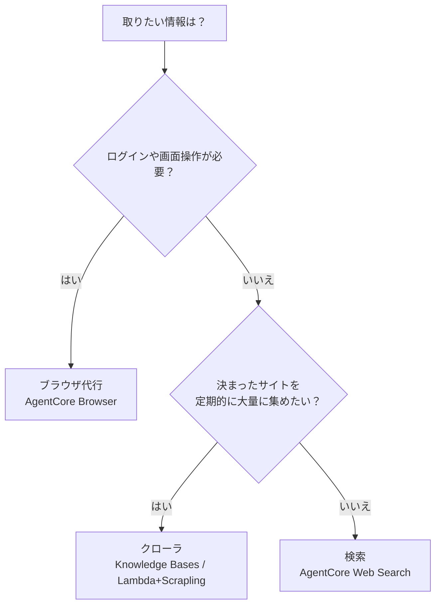

# 【比較】AWSでWeb情報を取る3方式の違い（検索・クローラ・ブラウザ代行）

!!! note "2026-11 時点の情報"
    料金・サービス名は 2026-11-25 時点の公開情報です。最新は末尾の出典（AWS 公式の料金ページ）で確認してください。

## 概要

AIエージェントや社内システムに「Webの情報」を取り込む方法は、大きく **検索（Search）**・**クローラ（Crawl / Scraping）**・**ブラウザ代行（AI Browser）** の3つに分かれます。AWS ではそれぞれ、AgentCore Web Search、Bedrock Knowledge Bases や Lambda / ECS ＋ Scrapling などの自前クローラ、AgentCore Browser が代表的な選択肢です。

速さ・取れる範囲・コストの性格がまったく違うため、「何を取りたいか」で選び分けるのが基本です。

### 例えるなら

| 方式 | 例え |
| --- | --- |
| 検索 | **図書館の司書に聞く**（答えのありかをすぐ教えてくれる） |
| クローラ | **全ページを丸ごとコピーして集める**（本棚ごと持ち帰る） |
| ブラウザ代行 | **人間がPCを操作する代わり**（ログインしてボタンを押してくれる） |

## 詳細比較

| 比較項目 | 1. 検索（Search） | 2. クローラ（Crawl / Scraping） | 3. ブラウザ代行（AI Browser） |
| --- | --- | --- | --- |
| **一言でいうと** | 図書館の司書に聞く | 全ページを丸ごとコピーして集める | 人間がPCを操作する代わり |
| **代表的なAWS構成** | AgentCore Web Search／Amazon Kendra（社内文書の検索） | Bedrock Knowledge Bases（Webクローラ）／Lambda・ECS ＋ Scrapling など | AgentCore Browser |
| **速さ** | 圧倒的に速い（ミリ秒〜数秒） | 巡回に時間がかかる（分〜時間） | 1ページごとの処理が遅い |
| **取れる範囲** | 検索エンジンに載っている公開情報 | 指定したサイトのページ全体 | ログインの内側・JavaScriptで動く画面も可 |
| **準備・運用** | インフラ管理・事前準備が不要 | おまかせ機能なら少なめ／自前ならルールを細かく決められるが保守が要る | セッション管理と、AIに操作させる仕組みが要る |
| **壊れやすさ** | 低い | サイトの構造変更・ボット対策で止まりやすい | 画面変更の影響を受けるが、AIが多少は吸収する |
| **得意なこと** | 最新ニュース・一般知識 | 社内専用の知識ベースづくり・定期収集 | 情報収集に加えて「予約・入力」などの操作 |
| **コスト感** | **従量課金**：Web Search は 1,000クエリあたり **$7**。初期費用ゼロ | **ピンキリ**：おまかせ機能はデータ量・保存量に課金。自前（Lambda等）なら最安にできるが開発・保守の人件費がかかる | **中〜高**：ブラウザ稼働は秒単位課金で安価（下の試算）。ただし画面をAIに読ませるトークン代が別にかかる |

### それぞれの詳細

**1. 検索（AgentCore Web Search）**
エージェントが検索クエリを投げ、結果（タイトル・URL・抜粋）を受け取る方式。APIキーの管理が要らず、AgentCore Gateway 経由でも Web Search API（InvokeWebSearch）でも **$7 / 1,000クエリ**（Gateway 側の追加料金なし）。例：月25,000クエリなら $175。東京リージョンでも利用できる。社内文書を探すなら Amazon Kendra が同じ「検索」の位置づけになる。

**2. クローラ（Knowledge Bases／Lambda・ECS ＋ Scrapling）**
決めたサイトを巡回してページを丸ごと保存し、ベクトル化して知識ベースにする方式。Bedrock Knowledge Bases の Web クローラなら設定だけで始められ、自前で Scrapling 等を動かせば対象・頻度・抽出ルールを自由に決められる。代わりに、サイトの構造変更やボット対策で止まったときの手直しが運用の負担になる。

**3. ブラウザ代行（AgentCore Browser）**
クラウド上の隔離されたブラウザを、AIが人間の代わりに操作する方式。ログイン・ボタン操作・JavaScriptで描画される画面にも対応できる。料金は稼働中の **vCPU 時間＋メモリ GB 時間**（us-east-1 で $0.0895/vCPU時間・$0.00945/GB時間とする解説が多い。CPU は実際に使った分だけ）。

- 試算（目安）：1 vCPU・2GB を10分間フルに使うと 約 $0.015＋約 $0.003 ≒ **約 $0.018（2〜3円程度）**。実際は待ち時間の CPU が課金されないため、これより下がることが多い
- 一方で、画面の内容を毎回 LLM に読ませるトークン代が別にかかるため、**大量巡回には向かない**

## よくある誤解

- **「検索APIでページ全体が取れる」** → 返ってくるのは主に抜粋とURL。本文を丸ごと使いたいならクローラかブラウザで取りに行く
- **「ブラウザ代行は高い」** → ブラウザの稼働料金自体は安い。高くなるのは **LLM のトークン代**
- **「自前クローラが一番安い」** → サーバー代は最安にできるが、壊れたときの修正など**人の手間**を含めると逆転することがある

## 実務での選び分け

- **今すぐ世の中の一般的な答えが欲しい** 👉 **検索**
- **指定したサイトの情報を毎日ゴッソリ集めてデータベース化したい** 👉 **クローラ**
- **ID・パスワードでログインして、画面をポチポチ操作しないと取れない情報がある** 👉 **ブラウザ代行**

組み合わせも一般的です。例：検索で候補URLを見つける → 必要なページだけクローラで本文を取る → ログインが要るサイトだけブラウザ代行に回す。

## ひとことまとめ

速さと手軽さなら検索、量と定期性ならクローラ、ログインや操作が要るならブラウザ代行。コストは「検索＝回数」「クローラ＝規模と人手」「ブラウザ代行＝AIのトークン代」で決まる。

## 出典・参考

（いずれも 2026-11-25 取得）

- [Amazon Bedrock AgentCore now offers a Web Search API（AWS What's New）](https://aws.amazon.com/about-aws/whats-new/2026/11/amazon-bedrock-agentcore-web-search-api/)
- [Announcing Web Search on Amazon Bedrock AgentCore（AWS Blog）](https://aws.amazon.com/blogs/aws/announcing-web-search-on-amazon-bedrock-agentcore-ground-your-ai-agents-in-current-accurate-web-knowledge/)
- [Amazon Bedrock AgentCore pricing（AWS 公式）](https://aws.amazon.com/bedrock/agentcore/pricing/)
- [Amazon Bedrock AgentCore Pricing: 12 Components Breakdown（cloudburn.io・Browser 単価の解説）](https://cloudburn.io/blog/amazon-bedrock-agentcore-pricing)
