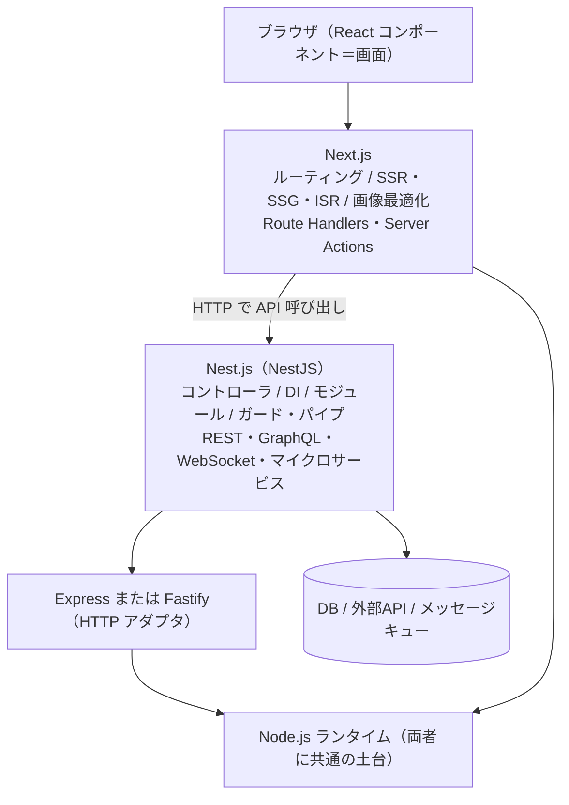

# 【比較】Next.jsとNest.jsの違い

## 概要

**Next.js** と **Nest.js** は、名前が1文字しか違わず、どちらも Node.js の上で動く TypeScript 製フレームワークです。しかし両者は**スタックの別の層を担当する、まったく別物**です。

- **Next.js** … 公式定義は「フルスタックの Web アプリケーションを構築するための **React フレームワーク**」。画面（UI）が主役で、SSR/SSG/ISR といったレンダリング戦略、ルーティング、画像最適化などを内蔵します。競合は Nuxt・Remix・SvelteKit です。
- **Nest.js**（公式表記は **NestJS**）… 公式定義は「効率的でスケーラブルな **Node.js サーバーサイドアプリケーション**を構築するためのフレームワーク」。画面は持たず、API・業務ロジック・マイクロサービスが主役です。競合は Express・Fastify・Spring Boot です。

したがって「Next.js と Nest.js のどちらが優れているか」は成立しない問いで、正しくは **「自分のプロジェクトはどの層を厚くしたいのか」** という問いになります。実務では **併用**（Next.js でフロント、Nest.js で API）も一般的な構成です。

> 📌 当サイトには「[node.jsとnext.jsの違い](nodejs-vs-nextjs.md)」もあります。あちらは **ランタイム（土台）とフレームワーク（道具セット）の階層関係**の説明です。本記事は **同じ土台の上に乗る2つのフレームワークが、それぞれ何を担当するか**の比較で、観点が異なる補完関係です。

### 図解：どの層を担当するか

## 詳細比較

| 項目 | Next.js | Nest.js（NestJS） |
| :--- | :--- | :--- |
| **分類** | React ベースのフルスタック**フロントエンド**フレームワーク | Node.js の**サーバーサイド**フレームワーク |
| **主役** | 画面（UI）とその配信方法 | API・業務ロジック・システム連携 |
| **競合** | Nuxt / Remix / SvelteKit / Astro | Express / Fastify / Spring Boot / Laravel |
| **ベース技術** | React（＋バンドラ・コンパイラを自動構成） | Express（既定）または Fastify を内部アダプタとして利用 |
| **設計思想の源流** | React のコンポーネントモデル | **Angular** に着想を得たモジュール＋DI 構成 |
| **中心概念** | ページ / レイアウト / Server Components / Client Components | モジュール / コントローラ / プロバイダ / ガード / インターセプター / パイプ |
| **TypeScript** | 対応（任意。JavaScript でも書ける） | **前提**（TypeScript ファーストで設計） |
| **DI（依存性注入）** | 仕組みとしては持たない | **中核機能**（テスト容易性・疎結合の柱） |
| **レンダリング** | SSR / SSG / ISR / PPR を内蔵 | 原則なし（テンプレートエンジンで HTML を返すことは可能） |
| **得意な通信** | HTTP（ページ配信＋Route Handlers による API） | REST / GraphQL / WebSocket / gRPC / Redis・MQTT・NATS・RabbitMQ・Kafka |
| **典型的なデプロイ形態** | サーバーレス／エッジ（Vercel など）に最適化 | **常駐サーバー**（コンテナ・PaaS・オンプレ）が基本 |
| **開発元** | Vercel | Kamil Myśliwiec 氏／Trilon |
| **正式表記** | `Next.js`（`.js` 付き） | `NestJS`（公式は `.js` を付けない） |

### バージョン・規模の実測値（2026-09-12 取得）

| 項目 | Next.js | Nest.js（NestJS） |
| :--- | :--- | :--- |
| 最新リリース | **v16.3.5**（2026-09-11） | **v12.0.0**（2026-08-27） |
| 直近のメジャー | v16.0.0（2025-10-21）／v15.0.0（2024-10-21） | v12.0.0（2026-08-27）／v11.0.0（2025-01-20） |
| GitHub スター数 | 約 142,000 | 約 76,600 |
| Node.js 要件 | 20.9 以上 | 20.19 以上 または 22.12 以上 |

> スター数の差は「人気の差」ではなく**母集団の差**です。フロントエンド開発者はバックエンド開発者より数が多く、Next.js はチュートリアルや個人サイトからも星が付きます。バックエンド単体の比較では Express が約 69,000 スターなので、Nest.js は**その領域では十分に大きい**規模です。

## それぞれの詳細

### Next.js — 「画面をどう速く届けるか」のフレームワーク

Next.js の関心事は一貫して**レンダリングと配信**です。同じ画面を「ビルド時に静的生成するのか（SSG）」「リクエストごとにサーバーで組み立てるのか（SSR）」「一部だけ動的にするのか（PPR）」を選べることが価値の中心にあります。

Next.js 16（2025-10-21）では次が入りました。

- **Turbopack が既定のバンドラに**（本番ビルド 2〜5倍、Fast Refresh 最大 10倍の高速化を公称）
- **Cache Components**（`"use cache"` ディレクティブ。キャッシュが暗黙ではなく**明示的なオプトイン**に変わった）
- **`middleware.ts` → `proxy.ts` へ改名**（ネットワーク境界を名前で明示。`middleware.ts` は非推奨）
- `params` / `searchParams` / `cookies()` / `headers()` の**同期アクセス廃止**（`await` 必須）

Next.js にも **Route Handlers**（`route.ts`）や **Server Actions**（`'use server'`）というサーバー側の仕組みがあり、小〜中規模なら「これ一本」でフルスタックが成立します。ここが Nest.js との境界を曖昧にしている最大の理由です。

### Nest.js — 「サーバー側の構造をどう保つか」のフレームワーク

Nest.js の関心事は**アーキテクチャの強制**です。Express は自由すぎて、規模が大きくなるとフォルダ構成もエラー処理も現場ごとにバラバラになります。Nest.js は Angular 由来の**モジュール／コントローラ／プロバイダ**という型を最初から与え、DI でテスト可能性と疎結合を担保します。

Nest.js は Express や Fastify を**置き換える**のではなく、その上に抽象レイヤーを被せる構造です。必要なら下位の Express API に直接触れます。また HTTP だけでなく、gRPC や Kafka・RabbitMQ などのマイクロサービストランスポートを同じ書き方で扱えます。

NestJS v12（2026-08-27）の主な変更は次のとおりです。

- **全公式パッケージの ESM 化**（既存の CommonJS アプリは Node.js の `require(esm)` により互換維持。CLI が CommonJS / ESM を選択可能）
- **Standard Schema 対応**（`@Body()` などに `schema` オプションが追加され、Zod・Valibot・ArkType をそのまま検証に使える）
- **CLI 全面刷新**（既定ツールが **Rspack**／**oxlint**／**Vitest** に。`nest upgrade` で v11→v12 移行を自動化）
- **`@nestjs/observe`** による標準オブザーバビリティ（HTTP・GraphQL・gRPC を横断して計測）
- ライフサイクルフックが**コンポーネント階層順に呼ばれる**よう変更（初期化・終了処理の順序に影響しうる破壊的変更）

## よくある誤解

- **誤解1：「名前が似ているので、同じジャンルの競合製品だろう」** — 誤りです。層が違います。Next.js の競合は Nuxt や Remix、Nest.js の競合は Express や Fastify です。**両者が直接比べられる場面は、実は「小規模アプリの API をどちらに置くか」に限られます。**
- **誤解2：「どちらか一方を選ばなければならない」** — 誤りです。**Next.js（フロント）＋ Nest.js（API）は定番構成の一つ**です。モノレポに両方を置き、Next.js から HTTP で Nest.js の API を叩く形がよく採られます。
- **誤解3：「Next.js に Route Handlers があるから Nest.js は不要」** — 規模次第です。画面と同じリポジトリで完結する CRUD 程度なら Next.js 単体で足ります。一方、**DI・モジュール境界・トランザクション制御・複数トランスポート（gRPC/Kafka）・常駐ワーカー**が要るなら Nest.js の土俵です。Route Handlers はあくまで「画面に付随する API」の置き場です。
- **誤解4：「Nest.js は画面をまったく作れない」** — 不正確です。Handlebars や EJS などのテンプレートエンジンでサーバーサイド HTML を返す MVC 構成は可能です。ただし**React のようなコンポーネント指向 UI のビルドと配信は担当しません**。そこは Next.js 等の役目です。
- **誤解5：「Nest.js は Express の代替（置き換え）である」** — 誤りです。Nest.js は既定で **Express を内部で使い**、その上に構造を与えるフレームワークです（Fastify に差し替えも可能）。競合ではなく**上に乗る**関係です。
- **誤解6：「表記はどちらも `.js` 付きが正しい」** — 誤りです。公式表記は **`Next.js`** と **`NestJS`** で、Nest 側は `.js` を付けません（検索のしやすさから `Nest.js` と書かれることは多く、本記事もタイトルではその慣用に従っています）。

## 実務での選び分け

まず押さえるべきは、**「どちらを選ぶか」ではなく「バックエンドをどこに置くか」が本当の論点**だという点です。

### Next.js 単体で足りるケース

- **マーケサイト・ブログ・LP・ドキュメントサイト**など、SEO とページ配信が主目的
- **管理画面つきの小〜中規模アプリ**で、API がその画面専用（外部に公開しない）
- チームが**フロントエンド中心**で、バックエンド専任がいない
- デプロイ先が **Vercel などのサーバーレス**で、常駐プロセスを持ちたくない

### Nest.js 単体で足りるケース

- **API サーバー／BFF／マイクロサービス**が成果物で、UI は別チーム・別リポジトリ（あるいはモバイルアプリのみ）
- **エンタープライズ要件**（層構造の強制、DI によるテスト容易性、権限制御をガードで集約）
- **gRPC・Kafka・MQTT など HTTP 以外**のトランスポートを扱う
- **バッチ・常駐ワーカー・WebSocket の常時接続**など、サーバーレスと相性が悪い処理がある

### 両方を使うケース（併用）

- **クライアントが複数ある**（Web＋モバイルアプリ＋外部パートナー向け API）。API を Next.js の中に閉じ込めると、Web 以外から使いづらくなります
- **フロントとバックで担当チーム・デプロイ頻度が分かれている**
- **業務ロジックが重い**（決済・在庫・ワークフローなど、UI の都合で壊したくないドメイン）

### 判断軸の早見表

| 問い | Yes なら |
| :--- | :--- |
| 成果物に**画面**があるか？ | 画面側は Next.js |
| その API を**Web 以外のクライアント**も使うか？ | API は Nest.js に切り出す |
| **DI・モジュール境界・レイヤー構造**を強制したいか？ | Nest.js |
| **常駐プロセス・長時間処理・WebSocket 常時接続**が要るか？ | Nest.js（サーバーレスは不向き） |
| チームは**5人以下**で、UI と API が同じ人か？ | Next.js 単体で始めて、必要になってから切り出す |

> 迷ったときの原則：**小さく始めるなら Next.js 単体、後から Nest.js を足す**。逆（Nest.js で作った API を Next.js の中に取り込む）よりも移行コストが低く済みます。

## ひとことまとめ

**Next.js は「画面をどう速く届けるか」、Nest.js は「サーバー側の構造をどう保つか」のフレームワーク**です。名前は似ていますがスタックの層が違い、競合しません。小規模なら Next.js 単体で API まで賄え、クライアントが増えるか業務ロジックが重くなった時点で Nest.js を後ろに足す——これが最も素直な進み方です。

例えるなら、Next.js は**客席とホール（お客様に料理をどう見せ、どう運ぶか）**、Nest.js は**厨房の動線設計（仕込み・調理・盛り付けの役割分担をどう崩さないか）**。小さな店なら一人で両方こなせますが、店が大きくなればホールと厨房は分けたほうが回ります。

## 出典・参考

- [Next.js Docs（Vercel 公式）](https://nextjs.org/docs) — 「Next.js is a React framework for building full-stack web applications」の定義／最新版 v16.3.5（2026-09-12 参照）
- [Next.js 16 リリースブログ（Vercel 公式）](https://nextjs.org/blog/next-16) — Turbopack 既定化・Cache Components・`proxy.ts`・Node.js 20.9+ 要件（2025-10-21 公開／2026-09-12 参照）
- [NestJS Documentation - Introduction（公式）](https://docs.nestjs.com/) — 「a framework for building efficient, scalable Node.js server-side applications」の定義／Express・Fastify・Angular 由来のアーキテクチャ（2026-09-12 参照）
- [Release v12.0.0 · nestjs/nest（GitHub）](https://github.com/nestjs/nest/releases/tag/v12.0.0) — ESM 移行・Standard Schema・CLI 刷新・`@nestjs/observe`・Node.js 要件（2026-08-27 公開／2026-09-12 参照）
- [NestJS v12 is Now Available（Trilon）](https://trilon.io/blog/nestjs-12-is-now-available) — v12 の設計意図と移行方針（2026-09-12 参照）
- GitHub API 実測（`repos/vercel/next.js`・`repos/nestjs/nest`・`repos/expressjs/express`）— スター数・リリース日（2026-09-12 取得）
- 当サイト「[node.jsとnext.jsの違い](nodejs-vs-nextjs.md)」（本記事と補完関係：あちらはランタイムとフレームワークの階層関係、本記事は同じ土台に乗る2フレームワークの担当領域の比較）
